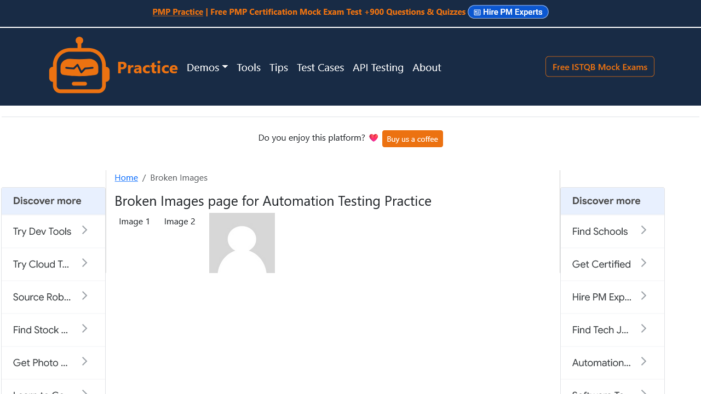
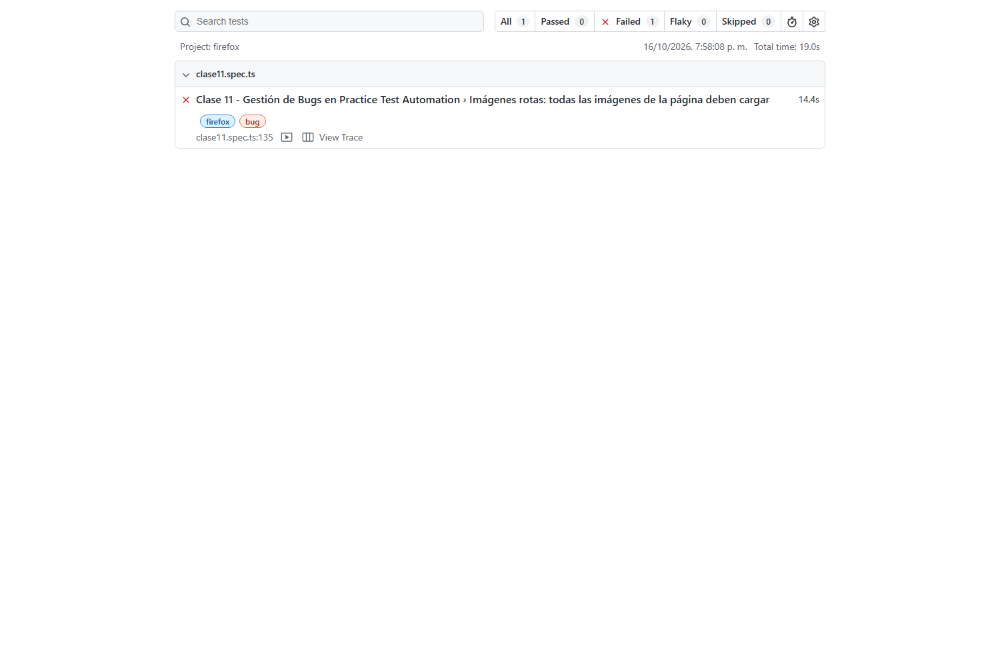
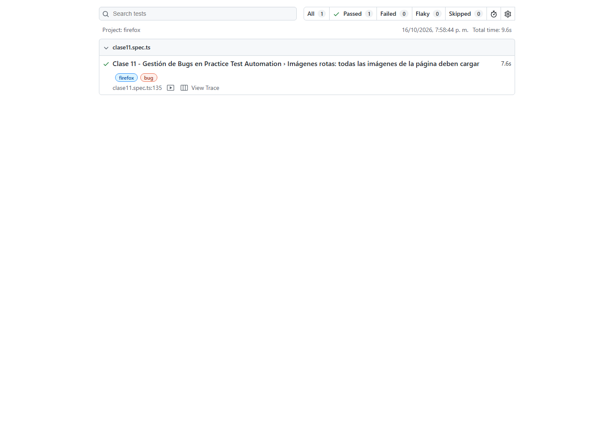
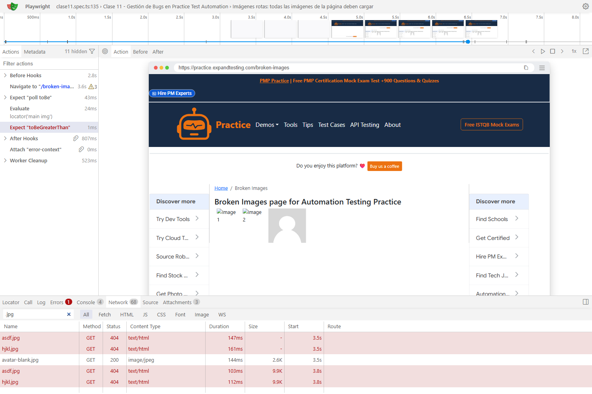

# BUG-001: Imágenes rotas responden 404 en /broken-images

## Información general

- **Responsable:** Bagner Francisco Ojeda Esquite — carné 1790-18-25212.
- **Fecha de detección:** 10 de octubre de 2026.
- **Última ejecución verificada:** 16 de octubre de 2026, hora de Guatemala.
- **Estado:** abierto; defecto conocido.
- **Test:** “Imágenes rotas: todas las imágenes de la página deben cargar”, etiqueta `@bug`, en [clase11.spec.ts](../tests/clase11.spec.ts).

## Descripción

En `/broken-images`, las imágenes `asdf.jpg` y `hjkl.jpg` no se muestran. Ambas solicitudes responden HTTP 404. El test espera a que termine la carga y verifica que las imágenes tengan `naturalWidth > 0`; la validación falla al encontrar un valor de cero.

## Ambiente

- Windows 11, según el ambiente documentado.
- Firefox, proyecto `firefox`; user agent Firefox/151.0.
- Playwright Test 1.61.1; proyecto 1.0.0.
- URL: https://practice.expandtesting.com/broken-images.
- Timeout de 30 segundos y un reintento. Versión del sitio no identificada.

## Severidad y prioridad

**Severidad baja:** dos imágenes no se visualizan, pero la página permanece accesible.

**Prioridad P3:** el problema es visual y no bloquea el flujo evaluado.

## Frecuencia

**Siempre en los tres intentos válidos observados en Firefox:** intento inicial, reintento y ejecución con fallo esperado. No se evaluaron otros navegadores para este reporte.

## Pasos para reproducir

1. Abrir Firefox y navegar a la URL indicada.
2. Abrir DevTools con F12 y seleccionar **Network**.
3. Recargar la página y esperar a que finalicen las solicitudes.
4. Buscar `asdf.jpg` y `hjkl.jpg` y comprobar sus respuestas HTTP 404.
5. Observar que las dos primeras imágenes no muestran su contenido.

Para reproducir el fallo automatizado, comentar temporalmente `test.fail(...)` y ejecutar desde la raíz:

```powershell
npx playwright test tests/clase11.spec.ts -g "rotas" --project=firefox --reporter=list,html
```

Conservar la evidencia y reactivar la instrucción al terminar. Este comando se incluye como referencia; no se ejecutó durante la simplificación del entregable.

## Resultado esperado

Todas las imágenes del contenido cargan correctamente, con `naturalWidth > 0` y sin respuestas HTTP 404.

## Resultado obtenido

`asdf.jpg` y `hjkl.jpg` responden HTTP 404, confirmado en la traza. La aserción falla con `Expected: > 0` y `Received: 0`.

La ejecución sin `test.fail()` terminó con **1 failed**; el reintento falló por la misma validación. Con `test.fail()` activo, terminó con **1 passed (9.6s)**, como fallo esperado y sin reintento. El defecto continúa presente.

## Evidencia

**Página durante el fallo:**



**Reporte rojo — fallo real:**



**Reporte verde — fallo esperado:**



**Network — respuestas HTTP 404:**



Las capturas del reporte rojo y de Network se obtuvieron de los artefactos guardados de la ejecución original, sin repetir las pruebas. Network corresponde a Trace Viewer.

- [Video del fallo](../evidencias/clase11/bug-001-fallo-video.webm).
- [Traza del fallo](../evidencias/clase11/bug-001-fallo-trace.zip).

Para abrir la traza desde la raíz:

```powershell
npx playwright show-trace "./evidencias/clase11/bug-001-fallo-trace.zip"
```

En **Network**, filtrar por `.jpg` para consultar ambos 404. En la aserción fallida, revisar el valor recibido: cero.

## Uso de test.fail()

El test conserva activa esta instrucción:

```typescript
test.fail(true, 'BUG-001: asdf.jpg y hjkl.jpg responden 404');
```

Playwright acepta la falla porque está declarada como esperada; el resultado verde **no significa que el bug esté corregido**. Si el test deja de fallar con esta anotación activa, se produce un *unexpected pass* y debe revisarse el cambio.

## Notas adicionales

- Posible causa: recursos ausentes o rutas incorrectas. Los 404 no permiten determinar la causa interna del servidor.
- La página es de práctica y las imágenes rotas podrían ser intencionales; aquí se documentan según el resultado esperado del laboratorio.
- Se conserva el enlace al [GitHub Issue #1](https://github.com/Xyusun99/pw-2026/issues/1); no se modificó el Issue.
- El PDF de la Clase 11 no está disponible en el repositorio; queda pendiente contrastar sus requisitos con esta entrega.
